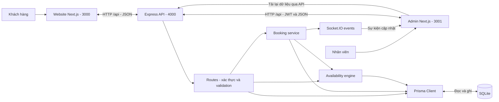
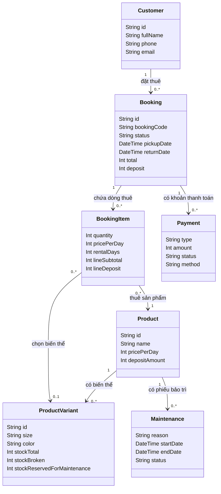
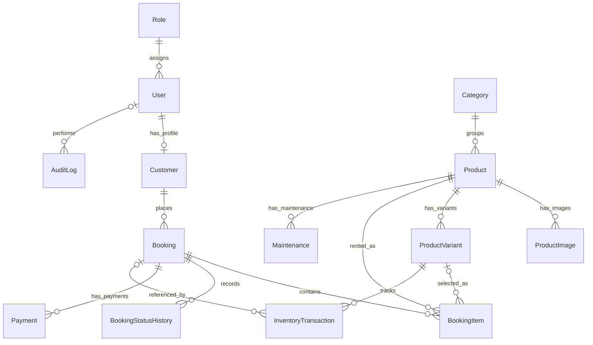
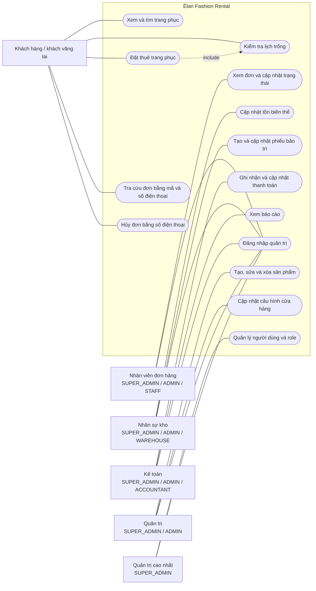
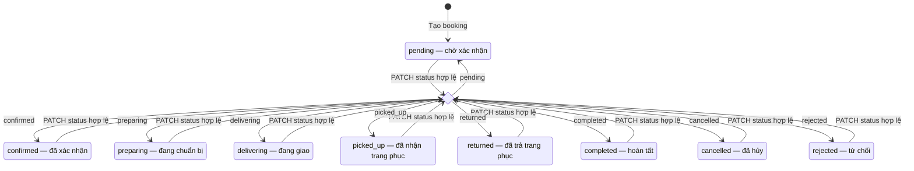
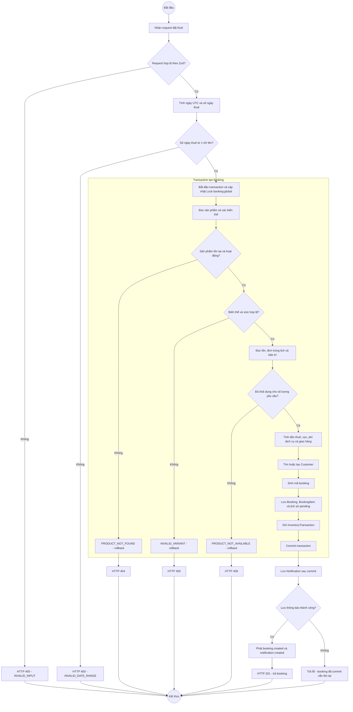
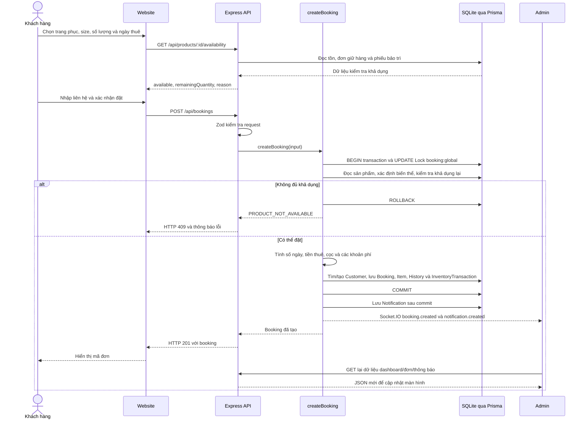

# Élan Fashion Rental

Élan Fashion Rental giúp cửa hàng cho thuê trang phục đưa bộ sưu tập lên website, nhận yêu cầu thuê theo ngày và quản lý đơn hàng, tồn kho, bảo trì, thanh toán trong một trang quản trị. Khách chọn trang phục, kích thước, ngày nhận/trả và nhận mã đơn để tra cứu; nhân viên xử lý đơn trên admin.

## Hệ thống làm được gì?

| Nhóm | Chức năng | Cách hệ thống xử lý |
| --- | --- | --- |
| Khách hàng | Tìm trang phục, lọc sản phẩm và xem chi tiết | Website gọi API catalog để lấy danh mục, ảnh, giá và biến thể size/màu; danh sách có phân trang. |
| Đặt thuê | Chọn ngày, size, số lượng và nhập thông tin liên hệ | Form hỏi API về khả dụng rồi gửi yêu cầu đặt thuê; backend kiểm tra lại và tạo đơn trạng thái `pending`. |
| Tra cứu | Xem đơn thuê, lịch sử trạng thái và thanh toán | Khách nhập đồng thời mã đơn và số điện thoại đã dùng khi đặt. |
| Đơn hàng | Xem danh sách, lịch nhận/trả và cập nhật trạng thái | Admin gọi API booking; backend ghi trạng thái mới, lịch sử thay đổi và audit log. |
| Sản phẩm và kho | Quản lý thông tin trang phục, ảnh, biến thể và tồn kho | Mỗi sản phẩm có các biến thể riêng; tồn tổng, hàng hỏng và hàng dành cho bảo trì được lưu theo biến thể. |
| Bảo trì | Lập và cập nhật phiếu bảo trì theo khoảng ngày | API lưu phiếu; kiểm tra khả dụng loại các khoảng ngày đang bảo trì `open` hoặc `in_progress`. |
| Thanh toán | Ghi nhận và cập nhật khoản thu/hoàn tiền của đơn | Admin lưu bản ghi `Payment` và cập nhật trạng thái thanh toán của booking. Đây là ghi nhận giao dịch; chưa có luồng gọi cổng thanh toán bên ngoài. |
| Dashboard và báo cáo | Xem đơn mới, đơn đang thuê, lượt trả sắp tới và thống kê | API đếm/tổng hợp dữ liệu từ booking, dòng sản phẩm, khách hàng và phiếu bảo trì. Chỉ số `revenueToday` hiện cộng tổng giá trị các đơn tạo trong ngày chưa hủy/từ chối. |
| Tài khoản quản trị | Đăng nhập, quản lý người dùng, vai trò và cấu hình | Backend kiểm tra mật khẩu bcrypt, cấp JWT và kiểm tra role tại các route tương ứng. |
| Thông báo | Nhận sự kiện khi có đơn mới hoặc đơn đổi trạng thái | Backend lưu thông báo và phát Socket.IO; các màn hình admin liên quan gọi lại API để cập nhật dữ liệu. |

Luồng chính của website là đặt thuê trực tiếp tại trang sản phẩm. Các trang tài khoản, giỏ hàng và yêu thích hiện là giao diện dẫn đường, chưa có luồng thao tác đầy đủ như đặt thuê và tra cứu đơn.

## Các phần phối hợp như thế nào?

Website và admin là hai ứng dụng Next.js riêng. Cả hai trao đổi JSON với cùng API Express; Prisma đọc/ghi database SQLite. Socket.IO gửi tín hiệu cập nhật đến admin, còn dữ liệu hiển thị được tải lại qua HTTP API.



Các điểm chính trong code:

- [Routes](apps/backend/src/routes): nhận request, kiểm tra dữ liệu bằng Zod, kiểm tra đăng nhập/role ở các endpoint yêu cầu và trả JSON.
- [Booking service](apps/backend/src/services/booking.service.ts): tạo đơn, tính tiền và cập nhật trạng thái.
- [Availability engine](apps/backend/src/lib/availability.ts): so sánh khoảng ngày với các đơn đang giữ hàng và phiếu bảo trì.
- [Prisma schema](apps/backend/prisma/schema.prisma): định nghĩa các đối tượng lưu trữ và quan hệ giữa chúng.
- [Realtime backend](apps/backend/src/realtime.ts) và [hook admin](apps/admin/src/lib/realtime.ts): phát/nhận sự kiện Socket.IO.

## Sơ đồ lớp — đối tượng nghiệp vụ

Sơ đồ lớp dưới đây mô tả các model Prisma cốt lõi và một số thuộc tính thực tế. Logic tạo đơn nằm trong các hàm service; các model biểu diễn dữ liệu và quan hệ, không phải hệ thống lớp kế thừa.



`Product` là mẫu trang phục; `ProductVariant` là một size/màu cụ thể với số lượng trong kho. `Booking` lưu khách hàng, lịch thuê và tổng tiền; `BookingItem` lưu sản phẩm được thuê cùng số lượng, đơn giá tại thời điểm đặt. Schema cho phép đơn có nhiều dòng, nhưng API tạo đơn hiện nhận một sản phẩm/biến thể cho mỗi request.

## Quan hệ dữ liệu lưu trong database



Mỗi dòng thuê liên kết đến đơn và sản phẩm, đồng thời có thể liên kết đến biến thể. `BookingStatusHistory` lưu các lần đổi trạng thái; `InventoryTransaction` lưu phát sinh kho; `AuditLog` ghi hành động cập nhật trạng thái của người thao tác. `Notification` lưu nội dung thông báo với `entityType`/`entityId` tham chiếu đối tượng nghiệp vụ, không phải khóa ngoại trực tiếp đến booking.

Xem [ERD chi tiết](docs/ERD.md) và [schema đầy đủ](apps/backend/prisma/schema.prisma) để tra cứu các model còn lại.

## Sơ đồ use case — ai sử dụng chức năng nào?

Các actor được nhóm theo role thực sự được API chấp nhận. Một người có role `ADMIN` hoặc `SUPER_ADMIN` có thể xuất hiện trong nhiều nhóm bên dưới. Use case đặt thuê bao gồm kiểm tra khả dụng ở backend; các chức năng quản trị yêu cầu đăng nhập và role phù hợp.



Use case hủy đơn công khai được API thực hiện khi số điện thoại khớp đơn và trạng thái chưa thuộc `completed`, `cancelled`, `returned`. Sơ đồ thể hiện chức năng API; không giả định mọi actor đã có một màn hình riêng cho từng chức năng. Các nút bo tròn là ca sử dụng, nằm trong ranh giới hệ thống; actor nằm bên ngoài. Use case xóa sản phẩm gọi `prisma.product.delete`; quan hệ khóa ngoại trong schema có thể chặn xóa sản phẩm đã được tham chiếu bởi đơn thuê.

## Biểu đồ trạng thái — booking

Khi tạo đơn, trạng thái đầu tiên là `pending`. Endpoint `PATCH /api/bookings/:id/status` kiểm tra JWT, role `SUPER_ADMIN`/`ADMIN`/`STAFF` và giá trị status trong chín lựa chọn dưới đây. Service hiện không kiểm tra ma trận chuyển trạng thái: từ bất kỳ status nào, request hợp lệ có thể đặt một status khác hoặc chính status hiện tại.



Điểm rẽ `Change` đại diện cho lựa chọn trong request, không phải một status lưu trong database. Không vẽ các trạng thái `completed`/`cancelled`/`rejected` thành điểm kết thúc tuyệt đối vì route cập nhật status vẫn có thể thay đổi chúng. Khi đổi trạng thái, service ghi `BookingStatusHistory`, cập nhật `Booking`, ghi `AuditLog` trong transaction, rồi lưu thông báo và phát `booking.updated` sau commit.

| Nhóm trạng thái | Ảnh hưởng đến kiểm tra lịch trống |
| --- | --- |
| `pending`, `confirmed`, `preparing`, `delivering`, `picked_up`, `returned` | Được tính vào các đơn đang giữ hàng theo `ACTIVE_BOOKING_STATUSES`. |
| `completed`, `cancelled`, `rejected` | Không được tính vào lượng đã đặt khi kiểm tra khả dụng. |

Route riêng `POST /api/bookings/:id/cancel` có kiểm tra trạng thái và số điện thoại/chủ đơn như mô tả trong use case; điều kiện này không được áp dụng tự động cho route `PATCH status`.

## Biểu đồ hoạt động — xử lý yêu cầu đặt thuê

Sơ đồ mô tả các quyết định của backend sau khi website gửi `POST /api/bookings`. Kiểm tra trên form là bước trước đó; backend vẫn kiểm tra lại dữ liệu và khả dụng khi tạo đơn.



Các lỗi ghi database trước commit làm transaction rollback và được chuyển đến middleware xử lý lỗi. `Notification` được tạo sau commit: nếu bước này lỗi, request có thể trả lỗi dù đơn đã được lưu. Sơ đồ giữ nguyên ranh giới transaction thực tế trong [booking service](apps/backend/src/services/booking.service.ts).

## Biểu đồ trình tự — dữ liệu đi qua luồng đặt thuê



Kết quả kiểm tra trên form giúp khách chọn ngày; nó không giữ chỗ. Backend kiểm tra lại trong transaction khi nhận yêu cầu tạo đơn. Transaction cập nhật dòng `Lock` trước khi đọc khả dụng và ghi đơn: đây là cơ chế dùng write lock của SQLite để xử lý các yêu cầu tạo booking cạnh tranh. Các bản ghi đơn, dòng thuê, lịch sử ban đầu và phát sinh kho được ghi cùng transaction; thông báo được lưu và sự kiện được phát sau khi transaction commit.

### Cách xác định còn hàng và tính tiền

Kiểm tra khả dụng dựa trên biến thể được chọn, số lượng yêu cầu, ngày nhận/trả, các booking thuộc `ACTIVE_BOOKING_STATUSES` và lịch bảo trì. Hai khoảng thuê giao nhau khi ngày bắt đầu của mỗi khoảng nằm trước ngày kết thúc của khoảng còn lại. Hàm hỗ trợ số ngày đệm; luồng tạo đơn hiện dùng mặc định `0`.

Các trạng thái đang giữ hàng trong code là `pending`, `confirmed`, `preparing`, `delivering`, `picked_up`, `returned`; `completed`, `cancelled`, `rejected` không nằm trong danh sách này. Đổi trạng thái ghi thêm lịch sử và audit log; không có state machine bắt buộc đi lần lượt qua mọi trạng thái.

Backend lấy giá từ sản phẩm trong database và tính lại, không nhận tổng tiền do client quyết định:

- Đơn giá ngày dùng giá 7 ngày chia 7, hoặc giá 3 ngày chia 3 nếu đủ số ngày và sản phẩm có mức giá đó; backend làm tròn xuống đơn giá gói.
- Tiền thuê bằng đơn giá ngày × số ngày thuê × số lượng.
- Phí dịch vụ bằng tiền thuê × tỷ lệ phí, làm tròn đến số nguyên.
- Giao tận nơi cộng phí 50.000; nhận tại cửa hàng có phí giao bằng 0.
- `total` bằng tiền thuê + phí dịch vụ + phí giao. Tiền cọc lưu riêng trong `deposit`, không cộng vào `total`.

Tồn được đọc từ `stockTotal`, `stockBroken` và `stockReservedForMaintenance`, rồi đối chiếu lượng đã đặt trùng ngày. Hàm hiện có quy ước `effectiveStock = 1` khi tồn tính được bằng 0; đây là hành vi của code hiện tại, không phải công thức luôn trả 0 cho mọi trường hợp hết tồn. Khi thiếu hàng do booking trùng lịch, engine có thể quét tối đa 60 ngày để gợi ý ngày khác.

## Công nghệ và cấu trúc

| Thư mục | Vai trò | Công nghệ | Cổng local |
| --- | --- | --- | --- |
| `apps/web` | Website khách hàng | Next.js 15, React 19, TypeScript, Tailwind CSS | 3000 |
| `apps/admin` | Trang quản trị | Next.js 15, React 19, Socket.IO client | 3001 |
| `apps/backend` | API, nghiệp vụ và realtime | Express, Prisma 5, SQLite, Socket.IO, JWT, Zod | 4000 |
| `docs` | Tài liệu kỹ thuật | [API](docs/API.md), [ERD](docs/ERD.md) | — |

## Cài đặt local

Dùng Node.js 22 LTS và npm. Chạy mọi lệnh dưới đây từ thư mục gốc repo. Trên PowerShell, dùng `npm.cmd` và `npx.cmd` nếu chính sách máy chặn `npm.ps1`.

```powershell
npm.cmd ci
```

### 1. Tạo các file môi trường thực tế

`.env.example` ở root chỉ là mẫu tham khảo. Tạo ba file sau; không copy toàn bộ mẫu vào cả ba ứng dụng.

`apps/backend/.env`:

```dotenv
DATABASE_URL="file:./dev.db"
PORT=4000
FRONTEND_URL=http://localhost:3000,http://localhost:3001
JWT_SECRET=replace-with-a-random-secret
JWT_REFRESH_SECRET=replace-with-a-different-random-secret
```

Chạy lệnh này hai lần, dùng mỗi kết quả cho một JWT secret; không giữ giá trị placeholder:

```powershell
node -e "console.log(require('node:crypto').randomBytes(32).toString('hex'))"
```

`apps/web/.env.local` và `apps/admin/.env.local` đều có:

```dotenv
NEXT_PUBLIC_API_URL=http://localhost:4000/api
NEXT_PUBLIC_SOCKET_URL=http://localhost:4000
```

Biến `NEXT_PUBLIC_*` được gửi đến trình duyệt: chỉ đặt URL công khai ở đây, tuyệt đối không đặt API key/token/password. Env thực tế, database, dependencies, cache và build output được loại khỏi Git. `.dockerignore` cũng loại env/database khỏi Docker build context.

### 2. Tạo database và dữ liệu demo

```powershell
npm.cmd run db:generate --workspace=apps/backend
npm.cmd run db:deploy --workspace=apps/backend
npm.cmd run db:seed --workspace=apps/backend
```

Các lệnh dùng migration SQLite hiện có. Database nằm ở `apps/backend/prisma/dev.db`.

Nếu Prisma 5 trên Windows báo `Schema engine error` khi database chưa tồn tại, chỉ với database local mới, tạo file database qua engine rồi chạy lại `db:deploy`:

```powershell
& ".\node_modules\@prisma\engines\schema-engine-windows.exe" cli --datasource "file:./apps/backend/prisma/dev.db" create-database
npm.cmd run db:deploy --workspace=apps/backend
```

Seed tạo dữ liệu và tài khoản demo; có cập nhật các setting mẫu. Chỉ seed database demo, không chạy seed trên dữ liệu thật.

### 3. Chạy trong ba terminal riêng

Mỗi terminal phải ở thư mục gốc repo:

```powershell
# Terminal 1: backend
npm.cmd run dev:backend
```

```powershell
# Terminal 2: website
npm.cmd run dev:web
```

```powershell
# Terminal 3: admin
npm.cmd run dev:admin
```

- Website: http://localhost:3000
- Admin: http://localhost:3001/login
- API health: http://localhost:4000/health
- Admin demo: `admin@example.com` / `Admin@123456` (chỉ dùng local).

`npm.cmd run dev` chỉ chạy website. Giữ ba terminal mở; `Ctrl+C` dừng server tương ứng. Nếu báo `EADDRINUSE`, cổng đang được một tiến trình sử dụng: dùng server đã chạy hoặc dừng tiến trình đó trước khi chạy lại. Đổi env không giải quyết lỗi trùng cổng.

## Build và kiểm thử

Dừng dev server trước khi build để tránh cùng ghi vào `.next`.

```powershell
npm.cmd run build
```

Website dùng `next/font` với Google Fonts; lần build đầu cần truy cập mạng để tải Inter và Playfair Display.

Backend có hai bài kiểm thử trong `apps/backend/test`. Các bài này cần backend đang chạy, database demo đã seed, và có tạo/xóa dữ liệu test. Chỉ chạy trên môi trường test/demo riêng; không trỏ vào database thật:

```powershell
npm.cmd run test --workspace=apps/backend
```

Nếu dùng database test khác, backend và tiến trình test phải dùng cùng `DATABASE_URL`; `API_URL` của tiến trình test phải trỏ đến backend đó.
