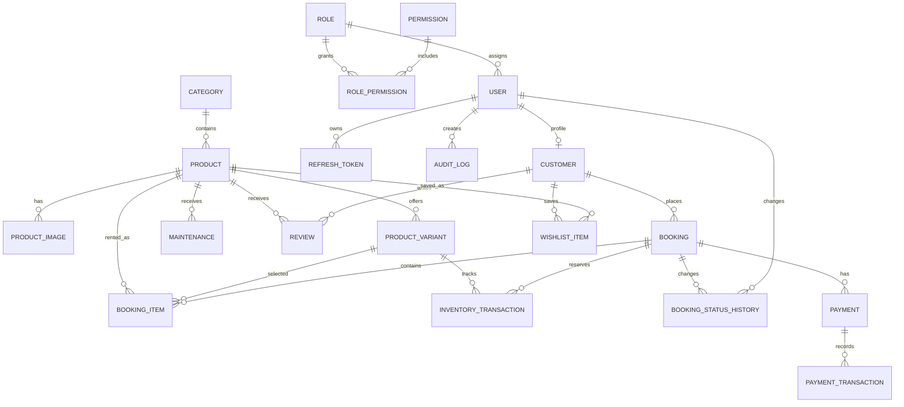

# Database ERD

## Entity Notes

| Entity | Purpose | Important indexes |
|---|---|---|
| `User`, `Role`, `Permission` | Authentication/RBAC | user.email, role.name, permission.code |
| `Customer` | Hồ sơ khách | email, phone, createdAt |
| `Product`, `ProductVariant` | Catalog + tồn theo size/màu | sku, categoryId, status, productId+size+color |
| `Booking`, `BookingItem` | Đơn thuê và dòng sản phẩm | bookingCode, customerId, pickupDate+returnDate, productId |
| `BookingStatusHistory` | Timeline trạng thái | bookingId |
| `Payment`, `PaymentTransaction` | Thanh toán/hoàn tiền | bookingId, status |
| `Maintenance` | Khoảng thời gian bảo trì | productId, startDate+endDate |
| `InventoryTransaction` | Ledger kho | variantId, bookingId, createdAt |
| `Notification` | Realtime notification center | userId+isRead, createdAt |
| `AuditLog` | Truy vết hành động admin | entityType+entityId, actorId, createdAt |
| `Lock` | SQLite transaction serialization | key |

## Double Booking Safety

SQLite không hỗ trợ `SELECT ... FOR UPDATE`, nên hệ thống dùng row `Lock(key = booking:global)`:

1. Transaction cập nhật row lock đầu tiên.
2. SQLite cấp write lock và tuần tự hóa các transaction đặt lịch cạnh tranh.
3. Transaction chạy `checkAvailability` theo đúng variant.
4. Nếu còn hàng thì tạo `Booking` + `BookingItem` + `InventoryTransaction` trong cùng transaction.
5. Nếu trùng, rollback và trả `PRODUCT_NOT_AVAILABLE`.
6. Chỉ sau khi commit thành công mới phát Socket.IO event.

Khi chuyển sang PostgreSQL, có thể thay row lock bằng advisory lock hoặc `SELECT FOR UPDATE` theo inventory row mà không đổi API contract.